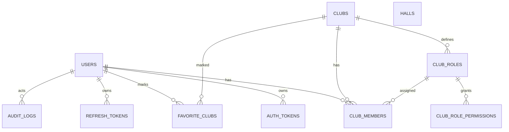

# Entity diagram

Kept in sync with `apps/api/src/db/migrations`. Tables marked **(built)** exist today; the rest are scheduled in later phases (spec section 17).

Built in Phase 0: `users`, `auth_tokens`, `refresh_tokens`, `clubs`, `club_roles`, `club_role_permissions`, `club_members`, `favorite_clubs`, `audit_logs`, `halls`.

Planned: `club_works`, `announcements`, `discussions`, `discussion_messages`, `events`, `event_reviews`, `forms`, `form_responses`, `registrations`, `recruitments`, `recruitment_positions`, `applications`, `hall_blocked_slots`, `hall_bookings`, `notifications`, `notification_preferences`, `chat_messages`. The full target diagram is in section 9.1 of the spec.
